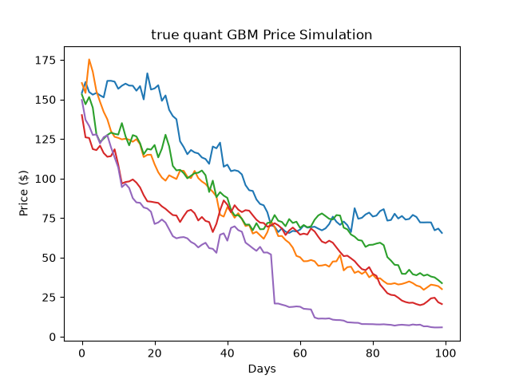
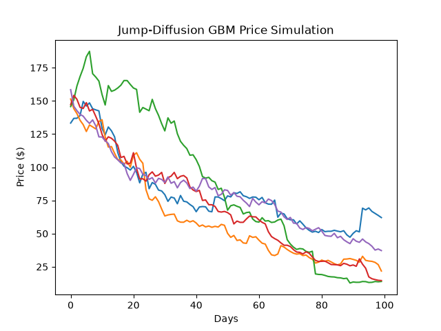
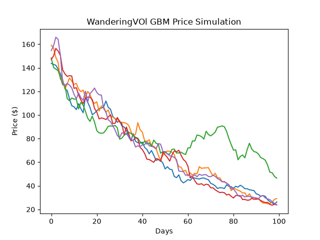
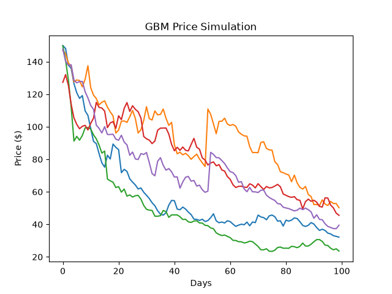
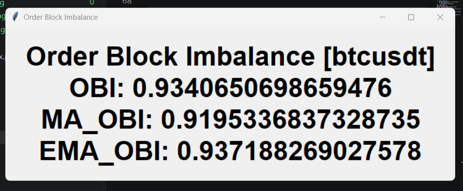
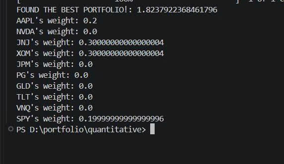

#*QUANTITATIVE DESK*
--
This has been a long holiday and thus I have time to compile all of my stuff into one repo.

* **gbm_normal**: a standard Geometric Brownian Motion simulation.
* **gbm_merton**: a Geometric Brownian Motion with jump-diffusion (poisson probability) simulation.
* **obi.py**: connects to a real-time asset and watch the Order Book Imbalance in real-time.
* **gbm_heston**: a Geometric Brownian Motion with moving volatility (not necessary mean-reverting, im lazy) simulation.
* **gbm_bates**: combines gbm_merton with gbm_heston.
* **correlation_matrix**: shows the correlation (cosine of vectors) between 2 assets, mapped as a NxN matrix.
* **port_return**: markowitz portfolio optimization stuff, i am dumb so i bruteforced the whole thing, which resulted in an embarassing time complexity O(10^n).

*preview: all of these simulated paths are ran on NVDA, 100 days and 5 times.*

*gbm bates* 

*gbm merton* 

*gbm heston* 

*gbm normal* 

*order block imbalance* 

*portfolio return/optimization* 

